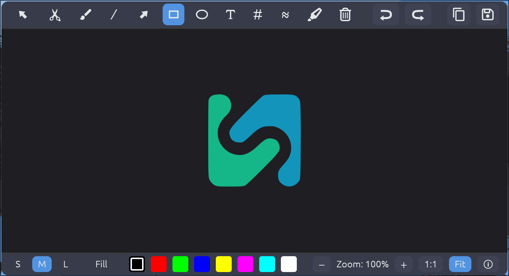

# slappyshot
"You miss 100% of the screenshots you don't annotate using slappyshot." - Wayne Gretzky



A fast, toolkit-independent screenshot annotation tool. Pipe in a screenshot, annotate it, copy or save. Built on [egui](https://github.com/emilk/egui)/[eframe](https://github.com/emilk/egui/tree/master/crates/eframe) — no GTK required.


## Installation

Packages are attached to each [release][releases], with a `SHA256SUMS` to check
them against. All of them are x86_64.

### Arch Linux

There is no AUR package — see below if you would like to maintain one. Until
there is, the `PKGBUILD` attached to each release installs the released binary:

```sh
curl -fsSLO https://github.com/guttermonk/slappyshot/releases/latest/download/PKGBUILD
makepkg -si
```

That gives you `slappyshot-bin`, but it will not upgrade along with the rest of
your system, which is the part only the AUR can provide.

**Packagers welcome.** Every release carries that `PKGBUILD` and a matching
`.SRCINFO`, both rendered, built and checked in an Arch container by the
release workflow — so adopting `slappyshot-bin` on the AUR is a push of two
files that CI has already tested, with no need to regenerate anything. The
template they come from is in [`packaging/aur/`](packaging/aur/).

### Debian, Ubuntu and derivatives

```sh
sudo apt install ./slappyshot-<version>-x86_64-unknown-linux-gnu.deb
```

Needs glibc 2.35, so Debian 12 or Ubuntu 22.04 and newer. `grim` and `slurp`
are recommended rather than depended on: slappyshot annotates an image handed
to it and captures nothing itself.

### Fedora and openSUSE

```sh
sudo dnf install ./slappyshot-<version>-x86_64-unknown-linux-gnu.rpm
```

Same glibc floor, which RHEL 9 and its rebuilds do not meet — they are on 2.34.
Use the AppImage or build from source there.

### AppImage

```sh
chmod +x slappyshot-<version>-x86_64.AppImage
grim - | ./slappyshot-<version>-x86_64.AppImage -f -
```

Nothing is bundled inside it. Every library slappyshot uses is dlopened and has
to come from the host regardless, and shipping a GL stack in an AppImage is how
they break on other people's drivers.

### Nix

```sh
nix run github:guttermonk/slappyshot -- --help
```

Or add the flake as an input and install `packages.<system>.default`.

### From source

See [Build from Source](#build-from-source).

There is no Flatpak, deliberately: slappyshot is normally handed its capture on
a pipe, and a sandbox between the host's grabber and the program is the one
thing it cannot have.

[releases]: https://github.com/guttermonk/slappyshot/releases

## Usage

```sh
# From a file
slappyshot --filename screenshot.png

# From stdin
grim - | slappyshot --filename -

# With output file
grim - | slappyshot --filename - --output-filename ~/Pictures/shot-%Y-%m-%d_%H:%M:%S.png
```

## Tools

| Icon | Tool | Shortcut | Notes |
|------|------|----------|-------|
| ↖ | Pointer | `p` | Drag canvas to pan; drag an annotation to move it |
| ✂ | Crop | `x` | |
| ✏ | Brush | `b` | |
| ∕ | Line | `l` | |
| ↗ | Arrow | `a` | |
| □ | Rectangle | `r` | |
| ○ | Ellipse | `e` | |
| T | Text | `t` | |
| # | Numbered Marker | `m` | Press `m` again to reset counter to 1 |
| ≈ | Blur | `w` | |
| H | Highlight | `h` | |
| 🗑 | Delete | `d` | Click an annotation to delete it |

Tool shortcuts are configurable via `[keybinds]` in the config file.

## Keyboard Shortcuts

### Tools
| Shortcut | Action |
|----------|--------|
| `p` | Pointer |
| `x` | Crop |
| `b` | Brush |
| `l` | Line |
| `a` | Arrow |
| `r` | Rectangle |
| `e` | Ellipse |
| `t` | Text |
| `m` | Numbered Marker (press again to reset counter) |
| `w` | Blur |
| `h` | Highlight |
| `d` | Delete |

### Style
| Shortcut | Action |
|----------|--------|
| `1` – `8` | Select palette color 1–8 |
| `Shift+S` | Small size |
| `Shift+M` | Medium size |
| `Shift+L` | Large size |
| `[` / `]` | Cycle size down / up |
| `f` | Toggle fill |

The tool, size and color you pick are remembered for the next run — see
[Remembered selection](#remembered-selection).

### Actions
| Shortcut | Action |
|----------|--------|
| `z` / `Ctrl+Z` | Undo |
| `y` / `Ctrl+Y` | Redo |
| `c` / `Ctrl+C` | Copy to clipboard |
| `s` / `Ctrl+S` | Save to file |
| `Ctrl+T` | Toggle toolbars |
| `q` | Quit |
| `Enter` | Configurable (default: copy + exit) |
| `Escape` | Configurable (default: exit) |

### Zoom & Pan
| Shortcut | Action |
|----------|--------|
| `=` / `+` | Zoom in |
| `-` | Zoom out |
| `0` | Actual size (100%) |
| `Shift+F` | Fit image to window |
| Scroll wheel | Zoom (centered on cursor) |
| Middle mouse drag | Pan |
| Pointer tool drag | Pan (when not over an annotation) |

### Tool Modifiers

- **Arrow / Line**: Hold `Shift` to snap to 15° increments
- **Rectangle / Ellipse**: Hold `Shift` for a square/circle
- **Highlight**: Hold `Ctrl` to switch between block and freehand mode

## Command Line

```
slappyshot [OPTIONS]

Options:
  -f, --filename <FILE>                   Input image, or '-' for stdin
      --output-filename <FILE>            Output filename template (supports chrono format specifiers)
      --fullscreen                        Start fullscreen
      --copy-command <CMD>                Command to pipe image to on copy (e.g. wl-copy)
      --config <FILE>                     Path to config file
      --initial-tool <TOOL>               Tool to select on startup
      --annotation-size-factor <FACTOR>   Scale annotation sizes up or down
      --early-exit                        Exit after copy/save
      --auto-copy                         Auto-copy to clipboard after each annotation change
      --no-zoom-to-fit                    Open at 100% instead of fitting the image to the window
      --no-remember                       Ignore the remembered tool, size and colour, and do not update them
  -h, --help                              Print help
  -V, --version                           Print version
```

## Remembered selection

The tool, size and colour you last used are carried over to the next capture,
so a session spent drawing red arrows opens on a red arrow rather than back at
the defaults. They are kept in `~/.local/state/slappyshot/state.toml` (or
`$XDG_STATE_HOME`), which is the program's own file and safe to delete.

`initial_tool` is the starting point rather than an override: it applies until
there is something remembered, and `--initial-tool` wins over both for the run
it is given on. Set `remember_last_used = false`, or pass `--no-remember`, to
turn the whole thing off. A remembered colour that is no longer in your palette
is dropped, so editing `color_palette` does not leave you drawing in a colour
the toolbar cannot show.

## Configuration

Config file location: `~/.config/slappyshot/config.toml`. A commented sample
listing every setting at its default is in [`config.toml`](config.toml) at the
root of this repository.

Keys are snake_case, and one spelled any other way is ignored in silence rather
than refused — if a setting appears to do nothing, check its spelling first.

```toml
[general]
# Start fullscreen
fullscreen = false
# Output filename template (chrono format specifiers supported)
output_filename = "/tmp/slappyshot-%Y-%m-%d_%H:%M:%S.png"
# Save to file after copying
save_after_copy = false
# Hide toolbars on startup
default_hide_toolbars = false
# Fill shapes by default
default_fill_shapes = false
# Corner roundness for rectangles (0 = sharp corners)
corner_roundness = 12
# Initial tool on startup. Only until there is a remembered one -- see
# remember_last_used below.
initial_tool = "arrow"
# Carry the tool, size and colour over from the last run
remember_last_used = true
# Command to run on copy (e.g. "wl-copy"). Falls back to native clipboard if unset.
copy_command = "wl-copy"
# Scale factor for annotation sizes
annotation_size_factor = 1.0
# Primary highlighter mode [block, freehand]
primary_highlighter = "block"
# Brush smoothing history size (0 = disabled)
brush_smooth_history_size = 5
# Zoom step factor per scroll tick
zoom_factor = 1.1
# Fit the image to the window on startup. Only ever scales down: a capture
# smaller than the window is shown at 100%, never magnified.
zoom_to_fit = true
# Pan step size in pixels (for keyboard panning)
pan_step_size = 50.0
# Disable window decorations
no_window_decoration = false
# Actions on Enter key [save_to_clipboard, save_to_file, exit]
actions_on_enter = ["save_to_clipboard", "exit"]
# Actions on Escape key
actions_on_escape = ["exit"]
# Actions on right click
actions_on_right_click = []

[color_palette]
# Hex colors shown in the toolbar
palette = ["#f0932b", "#eb4d4b", "#6ab04c", "#22a6b3", "#130f40", "#c825b8"]

[keybinds]
pointer   = "p"
crop      = "x"
brush     = "b"
line      = "l"
arrow     = "a"
rectangle = "r"
ellipse   = "e"
text      = "t"
marker    = "m"
blur      = "w"
highlight = "h"
delete    = "d"

[theme]
# Hex colors for UI theming (all optional)
panel_fill   = "#1e1e23"
text_color   = "#ffffff"
button_fill  = "#2a2a2f"
button_active = "#f0932b"
```

### Accepted and ignored

These parse without complaint and then do nothing: `floating_hack`,
`early_exit`, `auto_copy` and `disable_notifications` under `[general]`, the
whole `[font]` section, and the `--early-exit` and `--auto-copy` flags. Text
annotations use the system font egui resolves for itself.

Two action names are the same story: `copy_filepath_to_clipboard` does nothing,
and `save_to_file_as` is an alias for `save_to_file` rather than a dialog.

## Build from Source

```sh
cargo build --release
# binary at ./target/release/slappyshot
```

### Dependencies

- Rust toolchain
- On Wayland: wayland client libraries
- On X11: x11/xcb libraries

## Example: Sway / Hyprland

```sh
# Sway
grim -g "$(slurp)" -t ppm - | slappyshot --filename - \
  --output-filename ~/Pictures/Screenshots/shot-%Y%m%d-%H%M%S.png \
  --copy-command wl-copy --early-exit

# Hyprland (escape # in shell)
grim -g "$(slurp)" -t ppm - | slappyshot --filename - \
  --copy-command wl-copy --early-exit
```

## License

MPL-2.0
